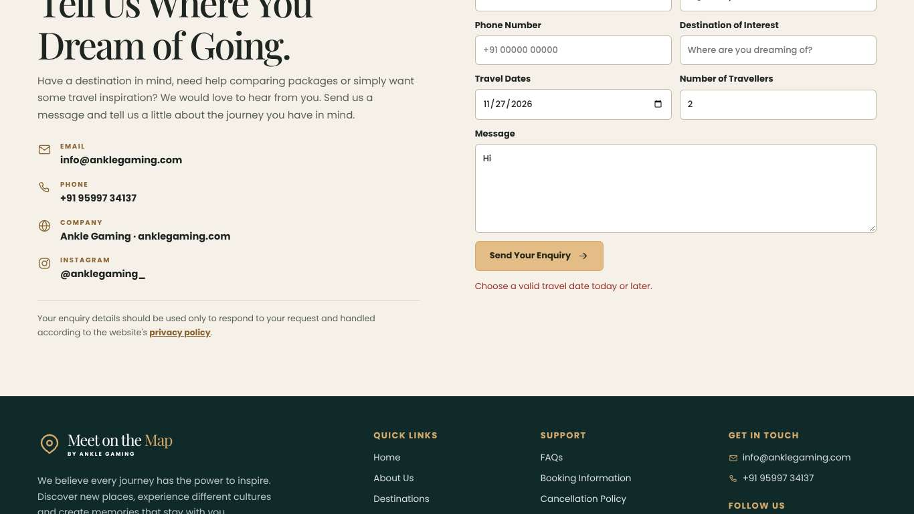

# MeetOnTheMap — Software Quality Assurance Report

| | |
|---|---|
| **Application** | Meet on the Map (travel website by Ankle Gaming) |
| **Version tested** | Git commit `e66dbe6` (branch `main`), repository `osteoncoder/MeetOnTheMap` |
| **Test date** | 28 November 2026 |
| **Test environment** | Site served with `npm start` (Node.js 22.22.3, Debian 12 Linux), tested at `http://localhost:3000` |
| **Browser** | Chromium 158.0.8127.0 (headless), driven by Puppeteer |
| **Tools** | Puppeteer (functional / UI / responsive automation), Google Lighthouse 13.6, axe-core (WCAG 2.1 AA), Chrome DevTools Protocol (network + CPU throttling, Performance API), Node `fetch` (API tests), `curl` |
| **Test cases** | 164 total: **134 passed, 20 failed, 3 blocked, 7 not applicable** |
| **Confirmed bugs** | **14** (0 Critical, 0 High, 7 Medium, 7 Low) |
| **Release recommendation** | **Conditional GO**: ready for demo / viva / portfolio use; fix the Medium items before real customers use it |

> **Honesty notes (please read first)**
> 1. **No live URL was supplied.** Your message still had the placeholder `[PASTE YOUR LIVE WEBSITE LINK HERE]`, the GitHub repo has no homepage URL, and my test sandbox cannot reach the public internet anyway. I therefore tested **the real application built from your source code**, running on a local server. It is the same HTML, JS, CSS and server code that a deployment would serve. Hosting-specific things (HTTPS, real network latency, CDN, server region) **could not** be tested. See §8 for how to repeat key checks on your live link.
> 2. **The site is not a "meeting" or "map" app.** Despite the name, *Meet on the Map* is a **travel information and enquiry website**: destinations, tour packages, blog, booking/contact/newsletter forms. It has **no login, registration, user profile, logout, map widget, geolocation, meeting creation/scheduling or sorting**. These items from the brief are marked **N/A**, not "failed" and not "passed".
> 3. Every bug below was **reproduced** by an automated test in a real browser (or a direct HTTP request) and has screenshot or response evidence. Anything I could not reproduce, or that depends on your requirements, is listed separately under **Suspected / requirement-dependent issues**.
> 4. **No website or source code file was modified.** All QA artefacts live only in this `qa-report/` folder. You can delete it at any time.

---

## PHASE 1 — Website exploration and feature inventory

### 1.1 Purpose
A travel brand website where visitors browse destinations and tour packages, read travel guides, and send **enquiries**. Forms store submissions on the server. They do **not** take payment, confirm bookings or send emails (the README says so, and the success message for bookings states "This is not a confirmed booking").

### 1.2 Architecture (useful for viva)
| Layer | File | Role |
|---|---|---|
| Server | `server.mjs` | Plain Node.js `http` server. Serves the static files, returns HTTP 404 for unknown pages, validates and saves form submissions as NDJSON files in `data/` |
| Front-end | `public/index.html` + `public/app.js` | Single-page approach: **all HTML is generated by JavaScript** on page load, based on the URL |
| Data | `public/catalog.js`, `public/content.js` | 5 destinations/packages, 6 blog posts, 4 policy pages |
| Styles | `public/style.css` | Mobile-first responsive CSS with breakpoints at 1150, 1050, 800 and 560 px |
| Unit tests | `test/server.test.mjs` | 1 Node test covering routes, validation and persistence (passes) |

### 1.3 User roles
Only **one role: anonymous visitor**. No admin panel, no accounts, no protected pages. (Submissions can only be read by someone with server file access.)

### 1.4 Pages / routes (24 valid routes)
| Route | Page | Main content |
|---|---|---|
| `/` | Home | 15 sections: Hero (slider), Trip search, About, Destinations, Why us, Package categories, How it works, Experiences, Gallery (filter), Testimonials (empty state), Wishes, Blog, Newsletter, FAQ, Contact |
| `/destinations` | Destination listing | 5 destination cards |
| `/destinations/{bali, switzerland, paris, maldives, india}` | Destination guide (×5) | Overview, best time, days, price, link to package |
| `/packages` | Package listing | Search/filter form + package cards + empty state |
| `/packages/{id}` (×5) | Package detail | Itinerary, "Good to know", **booking enquiry form** |
| `/blog` | Blog listing | 6 article cards |
| `/blog/{slug}` (×6) | Blog article | Article body |
| `/booking-information`, `/cancellation-policy`, `/privacy-policy`, `/terms` | Support pages | Policy text |
| anything else | 404 page | "Page not found" + Return home |

### 1.5 Interactive elements inventory (home page counts measured in the browser)
| Category | Items |
|---|---|
| **Header** (all pages) | Logo → `/`; 7 nav links (Destinations, Tour Packages, Experiences, Gallery, Travel Blog, About Us, Contact); "Plan a Trip" CTA; hamburger ☰ button (≤ 800 px) |
| **Hero** | 3 slider dots (Switzerland / Bali / Paris), "Explore Destinations", "Plan Your Journey", "Scroll to explore" |
| **Trip search form** (home + /packages) | Destination (select), Travel date (date), Travellers 1–12 (select), Trip type (select), "Search Trips" |
| **Gallery** | 6 filter chips (All + 5 categories), "Explore the Gallery" button |
| **FAQ** | 5 expandable questions (`<details>`) |
| **Forms** | Newsletter (email) · Contact (name, email, phone, destination with suggestions, date, travellers, message) · Booking enquiry on each package (name, email, date, travellers, message, hidden trip id) |
| **Section CTAs** | Get to Know Us, Discover All Destinations, Why Travel With Us, Browse Tour Packages, Start Planning, Find Your Experience, Read More Reviews, Read Travel Stories, View Destination ×5, View Details ×5, Read guide ×6 |
| **Footer** (all pages) | 8 quick links, 5 support links, mailto, tel, Instagram, anklegaming.com (×2) |
| **Totals on home page** (measured) | 67 links, 14 buttons, 3 forms (search, newsletter, contact), 12 visible form fields, 24 images |

---

## PHASE 2 — Functional testing (summary)

Full step-by-step cases are in **[`TEST_CASES.md`](TEST_CASES.md)** and **[`test-cases.csv`](test-cases.csv)** (opens in Excel).

| Feature | Expected | Actual (observed) | Status |
|---|---|---|---|
| All 24 routes open by direct URL | HTTP 200, correct heading, no JS errors, all images load | All 24 OK, 0 console errors, 0 broken images | ✅ PASS |
| Header nav (7 links) from another page | Correct page/section shown | All 7 correct | ✅ PASS |
| Logo / "Plan a Trip" CTA | `/` and `/#contact` | Correct | ✅ PASS |
| Active menu highlighting | Current section marked | "Tour Packages" marked on `/packages/bali` | ✅ PASS |
| Footer links (19) | No broken internal links | 0 broken; external links have `rel="noopener noreferrer"` | ✅ PASS |
| **"contact us" link on destination guides** | Goes to contact form | **Does nothing**: `#contact` does not exist on that page | ❌ FAIL → BUG-02 |
| Hero slider dots | Image + caption change | All 3 work, images load, `aria-pressed` updates | ✅ PASS |
| Gallery: "Explore" + 6 filters | 6 → 9 photos; correct category counts | 6→9; counts 2/2/2/2/1 correct | ✅ PASS |
| FAQ accordion | Opens/closes | Works | ✅ PASS |
| Trip search (all filters) | Correct results, filters kept | Maldives + Island Escape + 2 → 1 result; filters retained | ✅ PASS |
| Group-size boundary (Maldives max 6) | 6 → 1 trip, 7 → empty state | Exactly so; "Clear filters" restores 5 | ✅ PASS |
| Search → package → booking form pre-fill | Date and travellers carried over | Carried over; travellers clamped to package max | ✅ PASS |
| Newsletter subscribe | Success message, saved | "Thanks! Your signup was saved." + record saved | ✅ PASS |
| Contact form (all fields / required only) | Success, saved | Success, record matches input | ✅ PASS |
| Booking enquiry | Success, saved with trip | "Your inquiry was received. This is not a confirmed booking." | ✅ PASS |
| **Date "today" for users west of UTC** | Accepted (picker allows it) | **Rejected by server** (contact and booking) | ❌ FAIL → BUG-01 |
| **Duplicate newsletter signup** | Detected | Stored twice | ❌ FAIL → BUG-03 |
| Loading indicator / double-click | "Sending…", button disabled, 1 request | Exactly so | ✅ PASS |
| Offline / network error | Friendly error | "Could not connect. Please try again." (red) | ✅ PASS |
| Mobile menu ☰ | Opens, link navigates, Esc closes | Works, focus returns to ☰ | ✅ PASS |
| Keyboard "Skip to content" | First Tab stop, jumps to main | Works | ✅ PASS |
| Refresh / back / forward / trailing slash | Page state kept | All OK | ✅ PASS |
| 404 handling (5 invalid URLs) | HTTP 404 + friendly page | All OK | ✅ PASS |
| **`/index.html`** | Home page | **Shows "Page not found"** | ❌ FAIL → BUG-06 |
| Login / registration / logout / profile / maps / meetings / sorting | — | **Feature does not exist** | ➖ N/A |
| Regression: project's own `npm test` | Pass | 1/1 pass | ✅ PASS |

---

## PHASE 3 — UI / UX testing

**What is good (verified):**
- Consistent design system: one palette (#102A2A dark, #D5A96B gold, cream), two fonts (Playfair Display + Poppins, self-hosted), consistent card and button styles on every page.
- No horizontal scrolling and no element runs off-screen on any of 8 page types at 5 screen sizes (§4).
- **0 broken images** across all 24 routes. All images have `width`/`height` set, so the layout does not jump (CLS ≤ 0.05).
- Proper **empty states**: "No matching trips" with a Clear filters link (`evidence/empty-state-no-trips.jpg`). The Testimonials section honestly says reviews will appear once real ones are shared.
- Loading indicator ("Sending…" + disabled button) and clear success/error colours (`evidence/newsletter-sending-state.jpg`, `newsletter-offline-error.jpg`).
- Branded 404 page with header, footer and "Return home" (`evidence/404-page.jpg`).
- Respects the "reduce motion" accessibility setting. Visible keyboard focus outline.

**Problems found (all measured, not guessed):**
| # | Observation | Evidence |
|---|---|---|
| U1 | **Low colour contrast** on small gold "eyebrow" labels and the newsletter privacy link (4.27 and 4.08 : 1; WCAG needs 4.5 : 1) | axe-core + Lighthouse → BUG-11 |
| U2 | **Very small text**: brand subtitle "BY ANKLE GAMING" 8 px, hero kicker 8 px on mobile, card labels 9–10 px | Responsive script (`TC-RESP-*` remarks) |
| U3 | Footer "Ankle Gaming" link has the same colour as the text around it (1.04 : 1) with no underline | axe `link-in-text-block` → BUG-12 |
| U4 | Listing pages (`/destinations`, `/packages`, `/blog`) and the 404 page use the generic homepage title in the browser tab | BUG-07 |
| U5 | Misleading button labels: **"Read More Reviews"** goes to the contact form (there are no reviews); **"Get to Know Us"** also goes to the contact form | Code + click test |
| U6 | On a 375×667 phone the hero fills the entire first screen, so the trip search form is only seen after scrolling | `evidence/home-top-375.jpg` |
| U7 | Mixed spelling: "TRAVELERS' WORDS" / "EVERY TRAVELER" (US) vs "traveller" everywhere else (UK) | Content review |
| U8 | Prices were shown in **US dollars** for an India-based company. **Resolved after testing:** switched to Indian Rupees (₹, Indian number format) at the owner's request | Package pages |
| U9 | With JavaScript disabled the page is **blank** except "Skip to content" (no `<noscript>` message) | `evidence/no-javascript-home.jpg` |

---

## PHASE 4 — Responsive testing

Each size was tested with real device emulation (touch + pixel ratio) on 8 page types: `/`, `/destinations`, `/packages`, `/packages/maldives`, `/destinations/bali`, a blog article, a policy page and the 404 page. Each page was scrolled top to bottom.

| Screen | Horizontal scroll | Elements off-screen | Menu type | Header overlap | Result | Evidence |
|---|---|---|---|---|---|---|
| Mobile 375 × 667 | None | None | ☰ hamburger ✔ | None | ✅ PASS | `home-top-375.jpg`, `resp-375x667_packages*.jpg`, `mobile-menu-open-375.jpg` |
| Mobile 390 × 844 | None | None | ☰ hamburger ✔ | None | ✅ PASS | `resp-390x844_*.jpg` |
| Tablet 768 × 1024 | None | None | ☰ hamburger ✔ | None | ✅ PASS | `home-top-768.jpg`, `resp-768x1024_*.jpg` |
| Laptop 1366 × 768 | None | None | Full menu ✔ | None | ✅ PASS | `home-desktop-1366.jpg`, `resp-1366x768_*.jpg` |
| Desktop 1920 × 1080 | None | None | Full menu ✔ | None | ✅ PASS | `home-top-1920.jpg`, `resp-1920x1080_*.jpg` |

Extra checks: the header was also checked at 320, 360 and 414 px with no overlap (`header-320.jpg`). Hero slider dots are 24×24 px on mobile, which meets the WCAG 2.2 minimum target size. The one weakness is the small text sizes listed in U2.

---

## PHASE 5 — Negative testing (summary)

| Input / action | Result | Status |
|---|---|---|
| Empty newsletter / contact / booking form | Blocked by browser, **no request sent** | ✅ |
| Invalid emails `abc`, `user@`, `user@@mail.com`, `user name@mail.com`, `a@b..com` | Blocked by browser with a clear message | ✅ |
| Same email sent straight to the API, bypassing the browser: `a@b..com` | **Accepted by server** (server rule is looser than the browser's) | ⚠ suspected |
| Letters in phone (`call me maybe`) | "Enter a valid phone number." | ✅ |
| Phone with no digits (`+-------`) | **Accepted and stored** | ❌ BUG-04 |
| Spaces-only name/message | Rejected, but with the message "Enter a name of up to 100 characters." | ❌ BUG-05 |
| Numbers-only name `1234567890` | Accepted | ⚠ requirement-dependent |
| 150 characters typed into Name | Field stops at 100 | ✅ |
| Message of exactly 2000 characters / API with 2001 | Accepted / rejected (HTTP 400) | ✅ |
| Travellers 0, 100, 2.5, −3 | All blocked | ✅ |
| Past travel date (form) | Blocked: "Value must be 11/28/2026 or later." | ✅ |
| Past date in URL `/packages?date=2020-01-01` | Shown as "Requested start: 2020-01-01" and pre-filled into the booking form | ❌ BUG-08 |
| Unicode / emoji / Hindi (`José Ñúñez 李雷 😀`, `नमस्ते!`) | Accepted and stored correctly | ✅ |
| XSS payloads in forms and URL | No script ran; treated as text | ✅ |
| Tampered hidden trip id / removed `max` attribute (DevTools) | Server rejects | ✅ |
| Double-click submit | Only 1 request | ✅ |
| Duplicate submission | Stored twice | ❌ BUG-03 |
| Invalid URLs (`/unknown-page`, `/packages/unknown`, `/Destinations`, `/destinations/bali/extra`) | HTTP 404 + friendly page | ✅ |
| Malformed URL `/%E0%A4%A` | HTTP 400 `{"error":"Invalid URL."}`, server stays up (raw JSON instead of the styled page, cosmetic) | ✅ |
| Refresh, direct URL, back/forward | Correct | ✅ |
| Malformed JSON, wrong Content-Type, 9 KB body, GET/PUT/DELETE on endpoints | 400 / 415 / 413 / 405 with clear messages | ✅ |

---

## PHASE 6 — Performance testing

All numbers were **measured**: median of 3 cold-cache loads in Chromium, read from the browser's Performance API. **Caveat:** the server ran on the same machine, so server response time is near 0 ms. A real host will add network delay on top.

### 6.1 Page load measurements
| Page | Profile | FCP | **LCP** | Load event | CLS | Requests | Transferred |
|---|---|---|---|---|---|---|---|
| `/` | Desktop, no throttling | 156 ms | 156 ms | 91 ms | 0.000 | 15 | 947 KB |
| `/packages` | Desktop | 80 ms | 124 ms | 54 ms | 0.000 | 14 | 940 KB |
| `/packages/maldives` | Desktop | 112 ms | 112 ms | 60 ms | 0.005 | 11 | 261 KB |
| `/blog/responsible-travel` | Desktop | 48 ms | 48 ms | 33 ms | 0.000 | 8 | 142 KB |
| `/` | **Mobile: Slow 4G (1.6 Mbps, 150 ms) + 4× slower CPU** | 1224 ms | **3136 ms ❌** | 3103 ms | 0.048 | 11 | 490 KB |
| `/packages` | Mobile | 1072 ms | 2104 ms | 4125 ms | 0.035 | 12 | 696 KB |
| `/packages/maldives` | Mobile | 1088 ms | 2020 ms | 1986 ms | 0.001 | 11 | 261 KB |
| `/blog/responsible-travel` | Mobile | 1000 ms | 1000 ms | 1330 ms | 0.000 | 8 | 142 KB |

Google's "good" thresholds are LCP ≤ 2.5 s and CLS ≤ 0.1. **Only the mobile home page misses LCP.**

### 6.2 Google Lighthouse 13.6 (scores out of 100)
| Page | Mode | Performance | Accessibility | Best Practices | SEO | LCP |
|---|---|---|---|---|---|---|
| `/` | Mobile | **86** | 90 | 100 | 100 | **4.2 s** |
| `/` | Desktop | 99 | 93 | 100 | 100 | 1.0 s |
| `/packages/maldives` | Mobile | 100 | 96 | 100 | 100 | 1.9 s |
| `/packages/maldives` | Desktop | 100 | 96 | 100 | 100 | 0.5 s |

Lighthouse simulates a slower phone than my own throttling, which is why its LCP (4.2 s) is higher than mine (3.1 s). Both agree the mobile home page is the slow one.

### 6.3 Other observations
- **Heavy images**: `street-food.webp` 394 KB, `switzerland.webp` 340 KB (the hero/LCP image). There is no `srcset`, so phones download the same full-size images as desktops. Lighthouse estimates 735 KB of image savings on desktop home.
- **No gzip/brotli compression and no ETag/Last-Modified headers.** Files sent with `Cache-Control: no-cache` therefore get fully re-downloaded on every visit (a conditional request returned 200 instead of 304).
- **Navigation speed** (warm cache, click → loaded): 59–86 ms. **No freezing**: at most 1 long task per page, Total Blocking Time 0 ms.
- Lazy loading works: hidden gallery photos are not downloaded until revealed.

---

## PHASE 7 — Security testing (safe, non-destructive)

| Check | Result | Status |
|---|---|---|
| Exposed API keys / secrets in HTML/JS/CSS | 0 matches (searched for api key, secret, token, password, AIza, sk_live, Bearer, firebase, mongodb) | ✅ |
| Authentication / authorization / protected routes | No accounts exist; `/admin`, `/login` → 404; no cookies set | ➖ N/A |
| Path traversal (`/..%2fserver.mjs`, `/%2e%2e/package.json`, `/.git/config`, `/data/contact.ndjson`, `/etc/passwd` …) | All 404, nothing leaked | ✅ |
| Reflected XSS via URL parameters | No script ran, payload not in DOM (date is regex-checked, other values only set via `.value`) | ✅ |
| Stored XSS via forms | Payload stored raw but **never displayed** anywhere, so not exploitable today | ✅ (note) |
| Mass assignment (`admin:true`, `__proto__`, fake `receivedAt`) | Only whitelisted fields stored; no prototype pollution | ✅ |
| Server-side validation independent of browser | Tampered trip id, travellers 50, oversized body → rejected | ✅ |
| Cross-origin form posting (CSRF-style) from another origin | Blocked: preflight fails, `text/plain` gets 415, 0 records stored | ✅ |
| External links (`target=_blank`) | All have `rel="noopener noreferrer"` | ✅ |
| Stored data protection | Files `600`, folder `700`, not web-accessible; plain-text JSON with no retention policy | ✅ (note) |
| **HTTP security headers** | Only `X-Content-Type-Options` present. **Missing**: CSP, X-Frame-Options, Referrer-Policy, Permissions-Policy (HSTS needed once on HTTPS) | ❌ BUG-09 |
| **Clickjacking** | Site renders inside an iframe on a foreign origin | ❌ BUG-09 |
| **Rate limiting / spam protection** | 25 rapid newsletter posts → all 25 accepted (HTTP 201) | ❌ BUG-10 |

> Testing-integrity note: the Chromium build I used launches with `--disable-web-security` by default. My first cross-origin test therefore wrongly appeared to succeed. I spotted this, removed the flag, re-ran the test, and confirmed with `curl` that the server's preflight response has no CORS headers. The corrected result (blocked) is the one reported.

---

## PHASE 8 — Cross-browser testing

| Browser | Status | Notes |
|---|---|---|
| Google Chrome (Chromium 158) | ✅ Tested | All 164 cases ran here. No browser-specific problems; none of the failures are Chrome-specific |
| Microsoft Edge | ⛔ **Blocked** | Cannot be installed in the sandbox. Edge uses the same Chromium engine, so it is *expected* to match Chrome, **but this was not verified** |
| Mozilla Firefox | ⛔ **Blocked** | Cannot be downloaded in the sandbox |

**Static compatibility review (done):** the two newest CSS features are safely optional. Scroll-driven hero parallax sits inside `@supports (animation-timeline: scroll())`, and cross-page fades use `@view-transition`, which unsupported browsers ignore. **Expected Firefox difference:** no hero parallax and no page-fade effect, which is cosmetic only. All JavaScript APIs used are supported by current Firefox and Edge. The date-picker and number-field look will differ (native browser controls).

**How to finish cross-browser testing yourself (15 minutes per browser):**
1. Open your live site in Edge, then in Firefox.
2. Run this smoke checklist in each: home loads with no layout breaks → click every header link → hero dots → gallery chips + "Explore the Gallery" → open an FAQ → search Maldives / 2 travellers → open the package → submit the booking form → submit newsletter with an invalid email (`abc`) then a valid one → submit the contact form empty, then valid.
3. Press **F12 → Console** on each page. There should be no red errors.
4. Press **Ctrl+Shift+M** (Firefox Responsive Design Mode) or **F12 → device toolbar** (Edge) and check 375, 768 and 1366 px.
5. Record Pass/Fail in `test-cases.csv` rows `TC-XB-002` and `TC-XB-003`.

---

## PHASE 9 — Bug reports (confirmed, all reproduced)

**Environment for all bugs:** commit `e66dbe6`, `npm start` on Node 22.22.3 / Debian 12, Chromium 158 headless, 28 Nov 2026. Each bug is reproduced by the automation script named in *Evidence*.

### BUG-01 — Today's date rejected for visitors in timezones behind UTC
| Field | Detail |
|---|---|
| Module | Contact form, Booking enquiry form (`server.mjs → validDate`, `app.js → dateMin`) |
| Severity / Priority | **Medium / Medium** |
| Steps to Reproduce | 1. Set the computer/browser timezone to one behind UTC, e.g. *Pacific/Honolulu* or *America/New_York* in the evening (when the UTC date is already "tomorrow"). 2. Open `/#contact` (or `/packages/bali`). 3. Fill the required fields and choose **today's local date**; the date picker allows it. 4. Submit. |
| Expected Result | Enquiry accepted (the date picker said the date was valid) |
| Actual Result | Red error **"Choose a valid travel date today or later."** Reproduced at 09:12 and 09:24 UTC: local date 2026-11-27, picker `min` 2026-11-27, server compares against UTC date 2026-11-28 |
| Evidence | `TC-CON-017`, `TC-BOOK-006`; `evidence/BUG-timezone-date-rejected.jpg`, `evidence/BUG-timezone-booking-rejected.jpg` |
| Root cause | The browser builds the minimum date from **local** time, but the server checks against the **UTC** date |
| Suggested Fix | Make both sides use the same rule. Simplest: on the server allow one day of tolerance (`t >= now − 1 day`), or send the user's timezone offset and compare with that |



### BUG-02 — "contact us" link on every destination guide does nothing
| Field | Detail |
|---|---|
| Module | Destination detail page (`/destinations/*`), sidebar |
| Severity / Priority | **Medium / High** (dead link on the main conversion path; one-line fix) |
| Steps to Reproduce | 1. Open `/destinations/bali`. 2. In the right-hand "Signature trip" box click **contact us**. |
| Expected Result | User is taken to the contact form |
| Actual Result | URL changes to `/destinations/bali#contact` but nothing happens: no element with id `contact` exists on destination pages. Same on all 5 destinations |
| Evidence | `TC-NAV-025`; `evidence/BUG-contact-us-link-destination.jpg` |
| Suggested Fix | In `app.js → detail()`, change `href="#contact"` to `href="/#contact"` |

### BUG-03 — Same email can subscribe to the newsletter repeatedly
| Field | Detail |
|---|---|
| Module | Newsletter (`/api/newsletter`) |
| Severity / Priority | **Low / Medium** |
| Steps | 1. Subscribe `dup@example.com`. 2. Reload and subscribe `dup@example.com` again. |
| Expected | Second attempt recognised ("You're already subscribed") and not stored twice |
| Actual | Both show "Thanks! Your signup was saved."; `newsletter.ndjson` contains 2 identical records |
| Evidence | `TC-NEWS-007` |
| Suggested Fix | Before appending, check if the (lower-cased) email already exists, or store subscribers in a keyed structure/database with a unique constraint |

### BUG-04 — Phone number with no digits is accepted
| Field | Detail |
|---|---|
| Module | Contact form / server validation |
| Severity / Priority | **Low / Low** |
| Steps | Fill the contact form with Phone = `+-------` and submit |
| Expected | "Enter a valid phone number." |
| Actual | "Thanks! Your message was received." and `+-------` stored |
| Evidence | `TC-CON-006`; `evidence/BUG-phone-symbols-accepted.jpg` |
| Suggested Fix | Additionally require a minimum number of digits, e.g. `phone.replace(/\D/g, "").length >= 7`, and add `pattern` on the input for instant feedback |

### BUG-05 — Misleading error message for a spaces-only name
| Field | Detail |
|---|---|
| Module | Contact form |
| Severity / Priority | **Low / Low** |
| Steps | Name = 3 spaces, Message = 3 spaces, valid email, submit |
| Expected | "Please enter your name." |
| Actual | "Enter a name of up to 100 characters." (the user is under 100 characters, so this is confusing) |
| Evidence | `TC-CON-004`; `evidence/BUG-whitespace-name-message.jpg` |
| Suggested Fix | Separate the checks: empty → "Please enter your name"; too long → "Name must be 100 characters or fewer" |

### BUG-06 — `/index.html` shows "Page not found"
| Field | Detail |
|---|---|
| Module | Routing (`app.js`) |
| Severity / Priority | **Low / Low** |
| Steps | Open `http://<site>/index.html` |
| Expected | Home page (or redirect to `/`) |
| Actual | HTTP **200** with the "Page not found" heading (status and content disagree) |
| Evidence | `TC-NAV-043`; `evidence/BUG-index-html-not-found.jpg` |
| Suggested Fix | Treat `index.html` as home in the client router, or 301-redirect `/index.html` → `/` in `server.mjs` |

### BUG-07 — Wrong / duplicate browser-tab titles
| Field | Detail |
|---|---|
| Module | SEO / page titles |
| Severity / Priority | **Low / Medium** (affects search results and browser history) |
| Steps | Open `/destinations`, `/packages`, `/blog`, `/unknown`, `/destinations/bali/extra` and read the tab title |
| Expected | Unique, accurate titles ("Destinations — Meet on the Map", "Page not found — …") |
| Actual | First four all show "Meet on the Map — Travel More. Explore More. Live More."; the 404 page at `/destinations/bali/extra` shows **"Bali — Meet on the Map"** |
| Evidence | `TC-NAV-048`, `TC-NAV-041` |
| Suggested Fix | Set `document.title` for listing pages and the 404 page; set the place title only when the route is actually valid (`!extra.length`) |

### BUG-08 — Past date from the URL shown as "Requested start" and pre-filled
| Field | Detail |
|---|---|
| Module | Package listing / booking form |
| Severity / Priority | **Low / Low** |
| Steps | Open `/packages?date=2020-01-01` and click any package |
| Expected | Past date ignored |
| Actual | Listing shows "5 trips · Requested start: 2020-01-01"; booking form pre-filled with 2020-01-01, which the browser then refuses on submit ("Value must be 11/28/2026 or later") |
| Evidence | `TC-SRCH-006`; `evidence/past-date-carried-to-booking.jpg` |
| Suggested Fix | In `params()`, drop dates earlier than today |

### BUG-09 — Missing HTTP security headers (clickjacking possible)
| Field | Detail |
|---|---|
| Module | Server (`server.mjs`) |
| Severity / Priority | **Medium / Medium** |
| Steps | 1. `curl -I http://<site>/`. 2. From another origin, embed `<iframe src="http://<site>/#contact">`. |
| Expected | `Content-Security-Policy` (incl. `frame-ancestors 'self'`), `X-Frame-Options: DENY`, `Referrer-Policy`, `Permissions-Policy`; site refuses to load in a foreign frame |
| Actual | Only `X-Content-Type-Options: nosniff`. Site renders fully inside the attacker's iframe |
| Evidence | `TC-SEC-003`, `TC-SEC-004`; `evidence/BUG-clickjacking-iframe.jpg` |
| Suggested Fix | Add the headers in the `createServer` handler, e.g. `X-Frame-Options: DENY`, `Content-Security-Policy: default-src 'self'; img-src 'self'; frame-ancestors 'none'`, `Referrer-Policy: strict-origin-when-cross-origin`; add HSTS on the HTTPS host |

### BUG-10 — No rate limiting or spam protection on forms
| Field | Detail |
|---|---|
| Module | Server API (`/api/newsletter`, `/api/contact`, `/api/booking`) |
| Severity / Priority | **Medium / Medium** (High before public launch) |
| Steps | Send 25 valid newsletter POST requests in a row from one client |
| Expected | Throttling (HTTP 429) or a CAPTCHA/honeypot after a few rapid submissions |
| Actual | All 25 returned HTTP 201 and were stored. A bot could fill the disk / inbox with junk |
| Evidence | `TC-SEC-006` |
| Suggested Fix | Per-IP rate limit (e.g. 5 requests / minute), a hidden honeypot field, and/or a CAPTCHA. The README also lists "abuse controls" as a pre-launch task |

### BUG-11 — Text colour contrast below WCAG AA
| Field | Detail |
|---|---|
| Module | UI / accessibility (`style.css`, `.eyebrow`, `.card-region`, newsletter privacy link) |
| Severity / Priority | **Medium / Medium** |
| Steps | Run Lighthouse → Accessibility on `/` (or axe DevTools) |
| Expected | Contrast ≥ 4.5 : 1 for small text |
| Actual | `#8a6432` on `#ece6d8` = **4.27 : 1** ("TRAVEL WITH CONFIDENCE", "A WINDOW TO THE WORLD" labels); `#8a6432` on `#eae1cd` = **4.08 : 1** ("A WORLD OF INSPIRATION" label and the "privacy policy" link in the newsletter box). Confirmed by both Lighthouse and axe-core with animations disabled. (Two lower values seen in one scan, 3.96 and 4.46, were measured mid fade-in animation and are **not** reported as defects) |
| Evidence | `TC-A11Y-001`; Lighthouse color-contrast audit |
| Suggested Fix | Darken the gold-deep text colour (e.g. `#7a5626`) for small labels, or increase their size/weight |

### BUG-12 — Other accessibility defects
| Field | Detail |
|---|---|
| Module | UI / accessibility |
| Severity / Priority | **Low / Low** |
| Actual | (a) Footer "Ankle Gaming" link has 1.04 : 1 contrast against nearby text and no underline (all pages). (b) On mobile the "Scroll to explore" link has no accessible name, because its text is hidden. (c) `/destinations`, `/packages`, `/blog` have **no `<h1>`**. (d) The 404 page skips heading levels (h1 → h3) |
| Evidence | `TC-A11Y-001` (axe rules `link-in-text-block`, `link-name`, `page-has-heading-one`, `heading-order`) |
| Suggested Fix | Underline inline links; add `aria-label="Scroll to destinations"`; render listing headings as `<h1>`; use `<h2>` in the footer of the 404 page or add a level |

### BUG-13 — Slow Largest Contentful Paint on the mobile home page
| Field | Detail |
|---|---|
| Module | Performance (home hero image, media files) |
| Severity / Priority | **Medium / Medium** |
| Steps | DevTools → Network "Slow 4G", Performance → CPU 4× slowdown, cold-load `/`; or run Lighthouse (mobile) |
| Expected | LCP ≤ 2.5 s |
| Actual | Measured LCP **3.14 s** (median of 3); Lighthouse mobile LCP **4.2 s**, Performance score 86. The hero image `switzerland.webp` is 340 KB and is the same file on every device; `street-food.webp` is 394 KB |
| Evidence | `TC-PERF-006`, `TC-PERF-010`; `lh-mobile` results in §6.2 |
| Suggested Fix | Compress the hero to ≤ 150 KB, serve smaller versions with `srcset`/`sizes`, add `<link rel="preload" as="image">` for the hero in `index.html` so the browser does not wait for JavaScript to discover it |

### BUG-14 — No compression and no cache validators
| Field | Detail |
|---|---|
| Module | Server (`server.mjs`) |
| Severity / Priority | **Low / Low** |
| Steps | `curl -I -H "Accept-Encoding: gzip, br" http://<site>/app.js` |
| Expected | `Content-Encoding: gzip/br`, `ETag` or `Last-Modified` (so repeat visits get 304) |
| Actual | No compression, no ETag/Last-Modified; conditional request returns full 200 |
| Evidence | `TC-PERF-001` |
| Suggested Fix | Use `zlib` brotli/gzip for text files and send an ETag. Most hosts (Netlify, Vercel, Nginx) do this automatically, so **re-check on your live host** |

### Suspected / requirement-dependent issues (behaviour confirmed, but "bug or not" depends on your requirements)
| # | Issue | Test |
|---|---|---|
| S1 | Full Name accepts numbers only (`1234567890`) and symbols | `TC-CON-007` (counted as Fail against the brief's "numbers in text-only fields") |
| S2 | Server accepts `a@b..com`; browser blocks it, so only direct API calls are affected | `TC-API-010` |
| S3 | Mobile menu does not close when tapping outside it (Esc and links do close it) | `TC-MENU-003` |
| S4 | Blank page without JavaScript; search engines that don't run JS see no content | `TC-NAV-049` |
| S5 | After "Explore the Gallery" keyboard focus is lost (the code tries to focus a non-focusable `<figure>`) | `TC-HOME-004` remark |
| S6 | Home `<h1>` sits outside the `<main>` landmark | Exploration |
| S7 | Personal data stored in plain-text files with no retention/deletion process (privacy compliance) | `TC-SEC-009` |
| S8 | UX items U5–U7 (misleading CTA labels, search below the fold on phones, spelling mix) | §3 |

---

## PHASE 10 — Test case documentation

The complete table (164 rows) with **Test Case ID, Type, Module, Scenario, Steps, Test Data, Expected, Actual, Status, Remarks** is in:
- **[`TEST_CASES.md`](TEST_CASES.md)**: readable on GitHub
- **[`test-cases.csv`](test-cases.csv)**: open in Excel / Google Sheets for your project file

Coverage by type:
| Type | Examples | Count |
|---|---|---|
| Functional (positive + N/A features) | Routes, nav, slider, gallery, search, forms, missing features | 73 |
| Negative | Invalid emails, empty forms, bad URLs, tampering | 26 |
| Boundary | Name 100/101, message 2000/2001, travellers 0/6/7/99/100, decimals | 9 |
| API | Status codes, malformed bodies, limits, mass assignment | 17 |
| Security | Headers, clickjacking, XSS, traversal, CSRF, rate limit, secrets | 14 |
| Performance | 8 load profiles, images, headers, navigation | 11 |
| Responsive | 5 viewports × 8 pages | 5 (40 page-views) |
| UI / Accessibility / Usability | axe scan of 48 page-views, keyboard, outside-tap menu | 3 |
| Regression | Project's `npm test` re-run | 1 |
| Cross-browser / Environment | Chrome, Edge, Firefox, static review, live URL | 5 |
| **Total** | | **164** |

Sample rows:
| Test Case ID | Test Scenario | Test Steps | Test Data | Expected Result | Actual Result | Status | Remarks |
|---|---|---|---|---|---|---|---|
| TC-SRCH-001 | Search with all filters | Home → set filters → Search Trips | Maldives / 2 / Island Escape / 2027-01-15 | 1 matching trip, filters kept | 1 trip "Maldives Island Retreat", filters kept | ✅ PASS | — |
| TC-SRCH-003 | Group-size boundary | Open `/packages?destination=maldives&travellers=6`, then `=7` | 6, 7 | 1 trip / empty state | 1 trip / "No matching trips" | ✅ PASS | Boundary |
| TC-CON-003 | Empty contact form | Click Send with no input | — | Blocked, no request | 3 fields flagged, 0 requests | ✅ PASS | Negative |
| TC-CON-017 | Timezone date | TZ Honolulu, pick today, submit | 2026-11-27 | Accepted | "Choose a valid travel date today or later." | ❌ FAIL | BUG-01 |
| TC-NAV-025 | "contact us" on destination | `/destinations/bali` → click link | — | Contact form | Nothing happens | ❌ FAIL | BUG-02 |
| TC-SEC-007 | Reflected XSS via URL | Open `/packages?destination=…` | XSS payloads | No script runs | 0 dialogs, not in DOM | ✅ PASS | Security |
| TC-RESP-001 | Layout 375×667 | Device toolbar 375×667, 8 pages | — | No h-scroll, hamburger | Pass on all 8 | ✅ PASS | Responsive |
| TC-REG-001 | Regression | `npm test` | — | All pass | 1/1 pass | ✅ PASS | Regression |

---

## PHASE 11 — Final QA report

**1. Website overview.** *Meet on the Map* is a dependency-free Node.js + vanilla JavaScript travel website with 24 routes: home (15 sections), 5 destination guides, 5 tour packages with booking enquiry, 6 blog posts and 4 policy pages, plus newsletter and contact forms whose data is validated and stored on the server.

**2. Testing objectives.** Verify every available feature works as intended; find functional, validation, UI, responsive, performance, accessibility and security defects; judge release readiness with evidence.

**3. Testing scope.** *In scope:* all 24 routes, every link/button/form on them, server API, responsiveness at 5 sizes, performance, accessibility (WCAG 2.1 AA), non-destructive security. *Out of scope / not possible:* live deployment (no URL), Edge and Firefox (cannot install), real physical phones, stress/load testing (excluded by you), destructive attacks, external sites (Instagram, anklegaming.com), actual opening of mail/phone apps.

**4. Testing methodology.** Black-box functional and negative testing through a real browser (Puppeteer automation that clicks, types and taps like a user); boundary-value analysis and equivalence partitioning for form fields; direct API testing; automated accessibility audit (axe-core, Lighthouse); performance measurement with network/CPU throttling and Lighthouse; white-box code review to locate root causes; regression run of the existing unit test. Each failure was re-checked to rule out test-script errors. Three script errors were found and corrected (smooth-scroll timing, a hidden-element false positive, and a browser flag), and are documented.

**5. Modules tested.** Routing & error pages, Header/Footer navigation, Hero slider, Gallery filter, FAQ, Trip search & filters, Destination guides, Package details, Blog, Newsletter form, Contact form, Booking enquiry form, Mobile menu & keyboard access, Server API, Security, Performance, Responsive layout, Accessibility.

| Metric | Value |
|---|---|
| **6. Total test cases** | **164** |
| **7. Passed** | **134** (87.0 % of the 154 executed) |
| **8. Failed** | **20** |
| **9. Blocked** | **3** (Edge, Firefox, live URL) |
| Not applicable | 7 (login, logout, profile, maps, meetings, sorting, auth checks) |
| **10. Confirmed bugs** | **14** (7 Medium, 7 Low), plus 8 suspected / requirement-dependent issues |
| **11. Critical issues** | **None.** No crash, data loss, security breach or blocked core journey was found. Most serious: BUG-01 (some users can't submit today's date), BUG-02 (dead contact link), BUG-09/10 (security hardening) |

*Why 20 failures but 14 bugs?* Some bugs cover several failed cases (BUG-01 = 2 cases, BUG-09 = 2, BUG-13 = 2). Some failed cases are requirement-dependent and listed as suspected (S1, S2, S3, S4).

**12. UI/UX observations.** Polished, consistent, attractive design with good empty states, feedback messages and a branded 404. Fully responsive at all 5 sizes with no horizontal scroll. Weaknesses: low contrast on small gold labels, 8–10 px text, two misleading CTA labels, generic tab titles, search form below the fold on small phones.

**13. Security observations.** Strong basics for a student project: server-side validation that can't be bypassed via DevTools, whitelisted fields, body-size limit, path-traversal protection, no XSS found, no secrets exposed, safe external links, cross-origin posting blocked, restrictive file permissions. Needed before launch: security headers / anti-clickjacking (BUG-09), rate limiting / anti-spam (BUG-10), and a data-retention policy.

**14. Performance observations.** Very fast on desktop (Lighthouse 99–100, LCP ≤ 1 s) and on inner pages on mobile (LCP ≈ 2 s). The **mobile home page misses the 2.5 s LCP target** (3.1 s measured, 4.2 s Lighthouse), caused by large un-resized images. Server sends no compression or ETags. No freezing or layout shift.

**15. Overall website quality.** **Good.** 87 % of executed tests pass, there are zero critical or high-severity defects, the code is clean and defensive, and accessibility/SEO scores are 90–100. The remaining issues are mostly validation edge cases, hardening and polish, and each has a clear, small fix.

**16. Recommended improvements (priority order).**
1. Fix BUG-02 (`#contact` → `/#contact`). Minutes of work, high visibility.
2. Fix BUG-01 timezone comparison.
3. Add security headers (BUG-09) and rate limiting + honeypot (BUG-10).
4. Optimise images: compress, `srcset`, preload the hero (BUG-13).
5. Darken small gold text; underline inline links; add `<h1>` to listing pages (BUG-11, BUG-12).
6. Duplicate-email check, phone digit rule, clearer empty-field messages (BUG-03/04/05).
7. Page titles, `/index.html`, past-date handling (BUG-06/07/08).
8. Enable compression/ETag (or confirm your host does it) (BUG-14).
9. Add a `<noscript>` message; close the mobile menu on outside tap; fix the two misleading CTA labels.
10. Before real customers: email notifications to the operator, privacy/retention policy, legal review of policies (also listed in your README).

**17. Final release recommendation — CONDITIONAL GO.**
- ✅ **GO for academic submission, viva demonstration and portfolio use.** Every core user journey works (browse → search → view package → send enquiry), with no critical defects.
- ⚠ **For a public launch with real customers**, first fix BUG-01, BUG-02, BUG-09, BUG-10, BUG-11 and BUG-13, then re-run this suite (regression) on the live URL, and complete the Edge/Firefox checks in §8.

---

## Appendix A — How to repeat the key tests yourself on the live site (Chrome DevTools & Lighthouse)

1. **Console errors:** open the site → `F12` → **Console**. Visit every page; there should be no red messages.
2. **Network / broken files:** `F12` → **Network** → tick *Disable cache* → reload. Sort by *Status*; nothing should be 4xx/5xx. Check *Size* for large images.
3. **Responsive:** `Ctrl+Shift+M` (device toolbar) → choose *Dimensions: Responsive* and type 375×667, 390×844, 768×1024, 1366×768, 1920×1080. Scroll each page and look for a horizontal scrollbar.
4. **Slow mobile simulation:** Network tab → throttling **Slow 4G**; Performance tab → ⚙ → CPU **4× slowdown**; reload home.
5. **Lighthouse:** `F12` → **Lighthouse** → Mode *Navigation*, Device *Mobile*, all categories → *Analyze page load*. Repeat for *Desktop*. Compare with §6.2.
6. **Security headers:** Network → click the first document request → **Headers → Response Headers**. Look for `Content-Security-Policy`, `X-Frame-Options`, `Strict-Transport-Security`. Or use https://securityheaders.com with your URL.
7. **Timezone bug (BUG-01):** `F12` → `⋮` → *More tools* → **Sensors** → *Location*: choose a preset such as *San Francisco* (this also changes the timezone). Reload, pick today's date in the contact form and submit (works only during the hours when your local date is behind UTC).
8. **Form validation:** follow the Negative table in §5. Type each value, submit, and note the message.
9. **Edge / Firefox:** see §8.

## Appendix B — Re-running the automated suite (regression testing)

The scripts are in `qa-report/automation/`. Requirements: Node 22+, then in an empty folder `npm i puppeteer-core @sparticuz/chromium axe-core lighthouse`. On a normal PC you can instead point `executablePath` in `lib.mjs` at your installed Chrome. Start the site with `npm start` and run:

```sh
node s1-nav.mjs        # exploration, routing, navigation, 404, refresh/back/forward
node s2-features.mjs   # slider, gallery, FAQ, search/filters, mobile menu, keyboard
node s3-forms.mjs      # newsletter / contact / booking: positive, negative, boundary
node s4-security.mjs   # API errors, headers, XSS, traversal, CSRF, rate limiting
node s5-responsive.mjs # 5 viewports + axe-core accessibility on all routes
node s6-perf.mjs       # throttled load metrics, images, navigation speed
```
Results are written to `results.json`; screenshots go to `qa-report/evidence/`.

## Appendix C — Quick viva points
- **Severity vs Priority:** severity = how badly it breaks the system (technical impact); priority = how soon it should be fixed (business urgency). Example: BUG-02 is *Medium* severity but *High* priority, because it's a dead link on the enquiry path and trivial to fix.
- **Why client-side and server-side validation?** Browser validation (`required`, `min`, `maxlength`) gives instant feedback but can be bypassed in DevTools. TC-BOOK-003/004 bypassed it, and the server still rejected the data. That is defence in depth.
- **Boundary value analysis:** test at, just below and just above limits (name 100 vs 101, travellers 6 vs 7 for Maldives).
- **Equivalence partitioning:** one representative per class of input (valid email, missing "@", missing domain, double "@", space).
- **Regression testing:** re-running existing tests after changes. The project's `npm test` plus this suite form the regression pack.
- **Blocked vs Failed:** *Failed* = test ran and result was wrong; *Blocked* = test could not run (Edge/Firefox not installable, no live URL).
